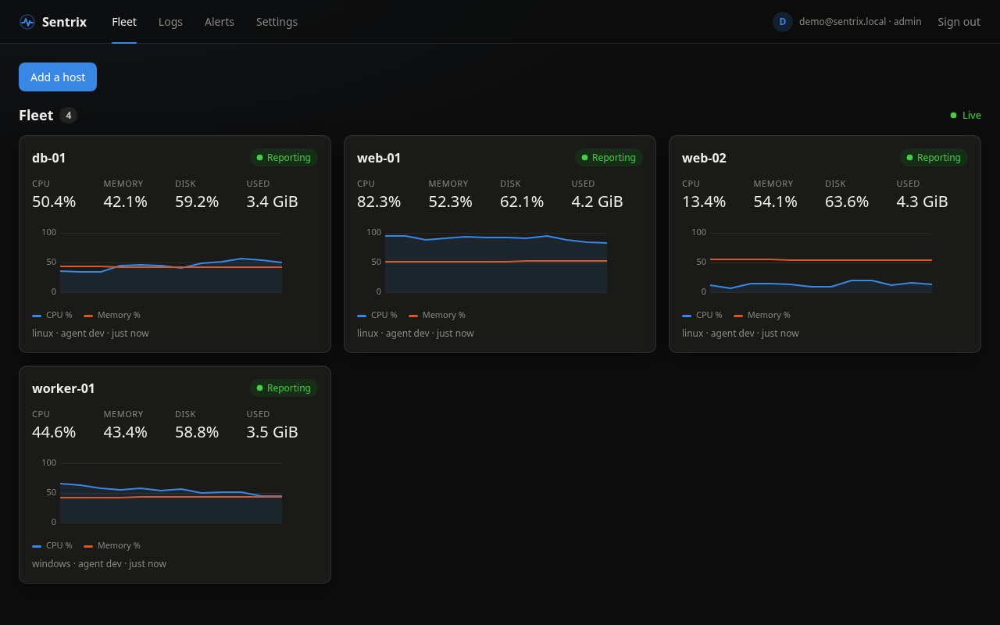
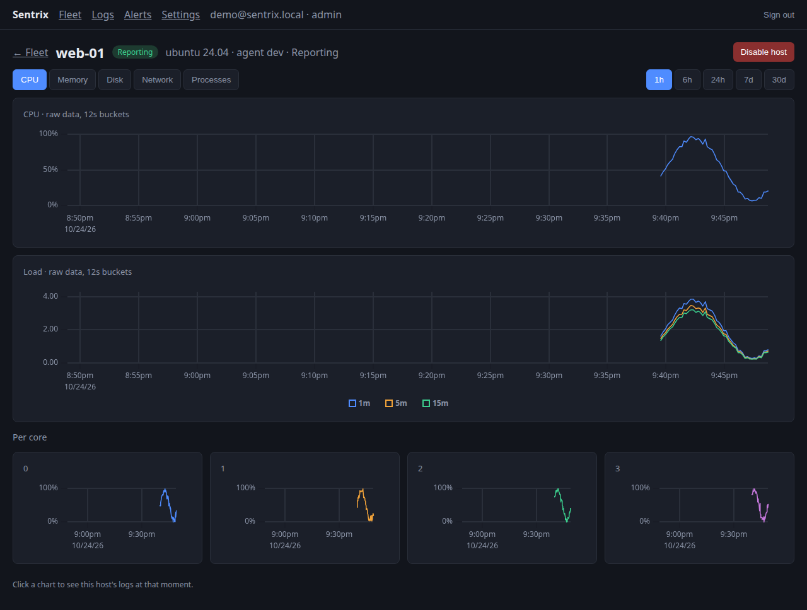
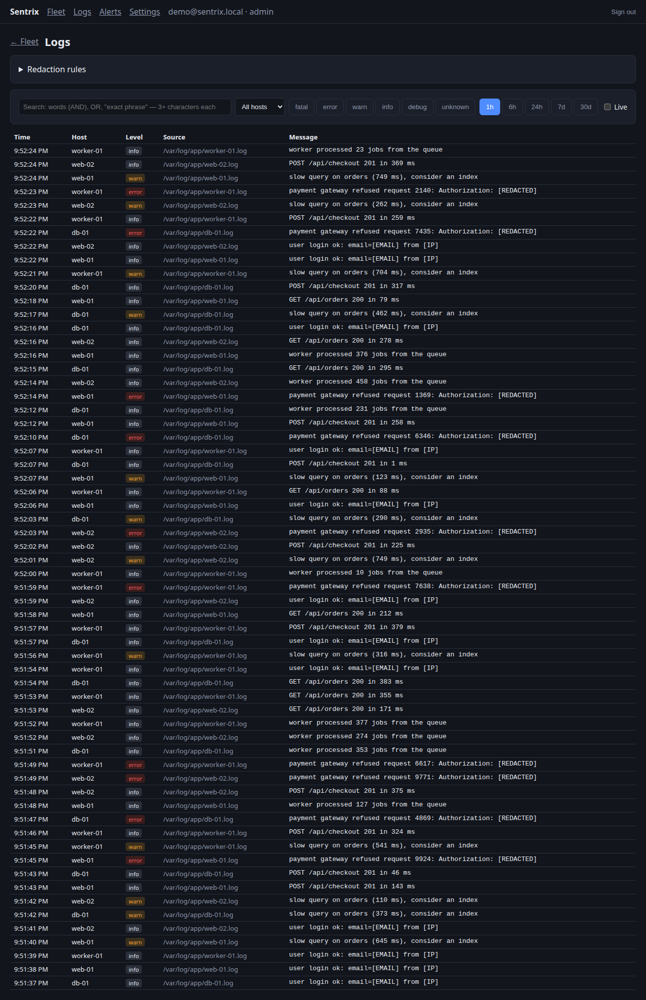
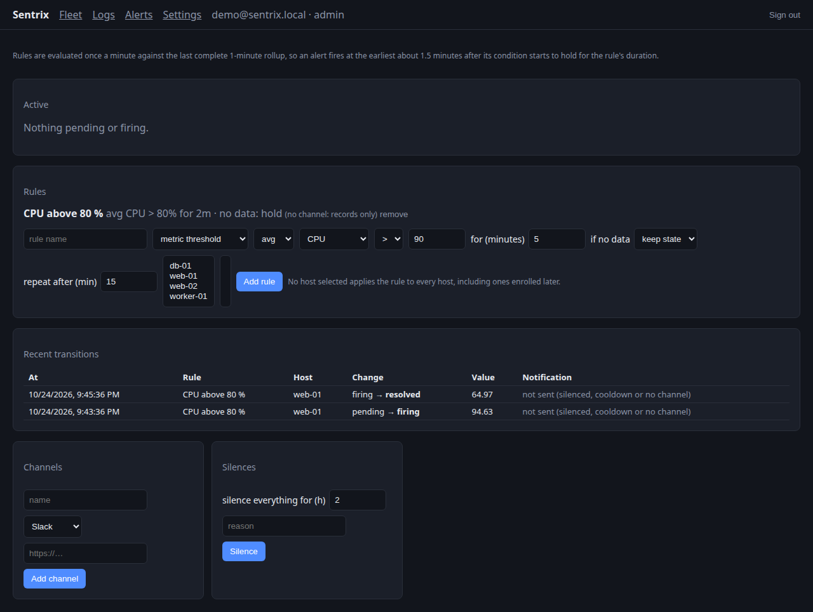
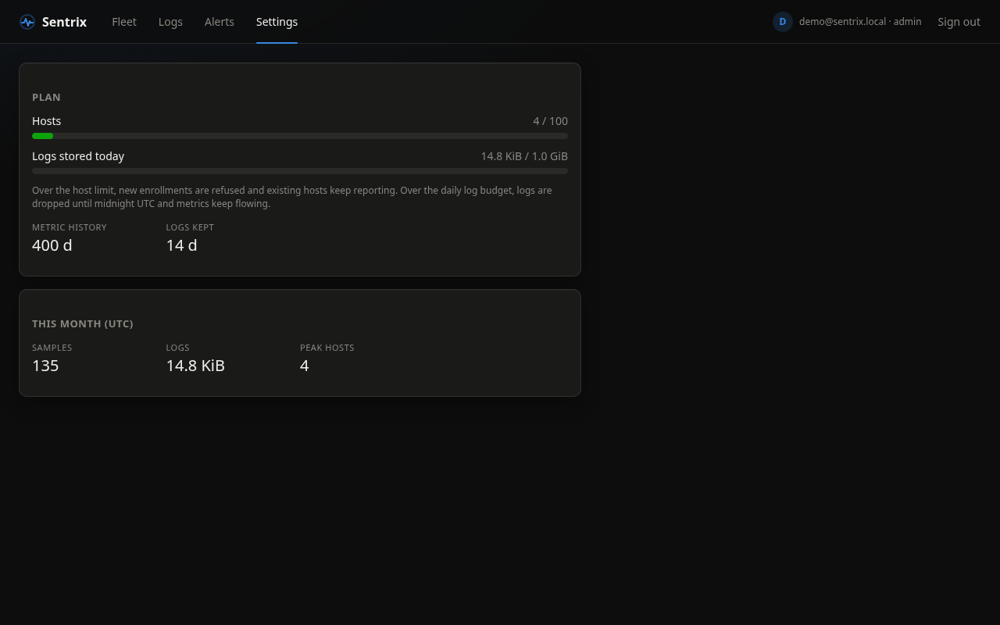
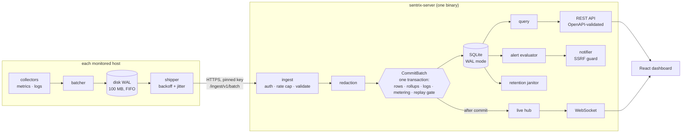

# Sentrix

Lightweight server monitoring: a Go agent for Linux and Windows, a single
binary server with an embedded React dashboard, and SQLite storage behind
ports that a ClickHouse adapter could implement.



- **Metrics**: CPU, memory, disk, load, network and disk I/O; per core,
  mount, device and NIC; top processes. Live charts over a WebSocket,
  history from 1-minute and hourly rollups.
- **Logs**: files (rotation-safe), journald, Windows Event Log. Secrets
  (tokens, passwords, emails, IPs, your own patterns) are **redacted on the
  server before storage**. Substring search, live tail.
- **Alerts**: thresholds and "host went silent", per-rule no-data policy,
  silences, Slack and webhooks behind an SSRF guard.
- **Operations**: per-tenant plans and metering, retention, export, GDPR
  erasure with an on-disk post-check, backup and a verified restore.

## Try it

```sh
docker build -t sentrix .
docker run --rm -p 8080:8080 sentrix
```

Open <http://localhost:8080> and log in with `demo@sentrix.local` and the
password printed in the container log (`demo running … password=…`). The
demo seeds a tenant and runs four simulated hosts — each one the **real
agent** (batching, disk buffer, pinned TLS, enrollment) fed by simulated
collectors — through the server's own ingest port. On a fresh CI machine it
takes **10.5 s** from `docker run` to live data on all four hosts
(`scripts/smoke-docker.sh`).

From source (Go 1.26, Node 22):

```sh
(cd web && npm ci && npm run build)
go build ./cmd/sentrix-server ./cmd/sentrix-agent
./sentrix-server serve --demo --data ./demo-data
```

## Screens

| | |
|---|---|
|  |  |
| host detail: CPU, load, per core | logs — the email, address and token were redacted before storage |
|  |  |
| alerts: a fire and resolve cycle | plan limits and metered usage |

## Install

Packages (`scripts/package.sh`): `.deb`/`.rpm` for amd64 and arm64 with
hardened systemd units, and a Windows zip.

```sh
# server
sudo dpkg -i sentrix-server_*.deb
sudo -u sentrix sentrix-server tenant create --data /var/lib/sentrix --name "My company"
sudo -u sentrix sentrix-server user create   --data /var/lib/sentrix --tenant TENANT --email you@example.com
sudo systemctl enable --now sentrix-server

# each host: a token from the dashboard ("Add a host")
sudo dpkg -i sentrix-agent_*.deb
sudo -u sentrix-agent sentrix-agent enroll --state-dir /var/lib/sentrix-agent --server https://SERVER:8443 --token TOKEN
sudo systemctl enable --now sentrix-agent
```

Windows: `sentrix-agent.exe enroll …` then `sentrix-agent.exe install` (a
service under its own virtual account; the credential is DPAPI-encrypted).
Operations: [`docs/runbook.md`](docs/runbook.md) ·
data: [`docs/data-handling.md`](docs/data-handling.md) ·
backups: [`docs/restore-drill.md`](docs/restore-drill.md).

## Architecture



Domain-driven layers (`domain` ← `app` ← `infra`), enforced by
`scripts/ci`: the import direction, SQL only in the SQLite adapter, 300 lines
per file. Every storage behaviour is a contract suite run against SQLite and
an in-memory reference store, including a reflected check that every
tenant-scoped method has a cross-tenant test. How to add another store:
[`docs/STORAGE-ADAPTERS.md`](docs/STORAGE-ADAPTERS.md).

## Measured

All on one i5-13400F (16 threads, NVMe) unless noted; how each was measured
is in [`docs/LOG.md`](docs/LOG.md).

| | |
|---|---|
| agent footprint | 13.3 MB RSS, 0.13 % of one core at a 5 s interval |
| ingest ceiling, full server path | 840–940 batches/s ≈ **8 400–9 400 hosts** at 5 s with per-core/disk/NIC detail (`BenchmarkIngestCeiling`) |
| core sample on disk | 67.6 B |
| logs, 1 M lines | 278 B/line with the search index; 58–125 ms per text search |
| server killed (`kill -9`) for 2 min under an agent | 0 samples lost, 0 stored twice (`scripts/outage.sh`) |
| backup / verified restore, 73 MiB database | 0.22 s / 1.02 s, every table identical |
| alert latency | ~1.5 min after the condition starts holding (1-minute rollups) |
| from-source build | ~13 s (web 3.3 s, Go 9.6 s with a cold build cache) |

Tests that matter most are mutation-checked: every guard (tenant isolation,
replay gate, redaction, SSRF deny list, retention, erasure post-check, …)
was broken on purpose to confirm a test fails. Survivors are listed in the
LOG, not hidden.

## Development

```sh
go test ./...            # Go tests (the contract suite runs on both stores)
go run ./scripts/ci all  # repo checks: line limit, layering, SQL placement
cd web && npm ci && npm test && npm run build
```

Plan and per-phase build log: [`docs/PLAN.md`](docs/PLAN.md),
[`docs/LOG.md`](docs/LOG.md).

## License

All rights reserved — see [`LICENSE`](LICENSE). The source is public to be
read and evaluated; reuse needs the author's permission.
